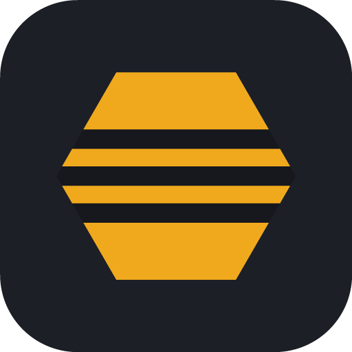
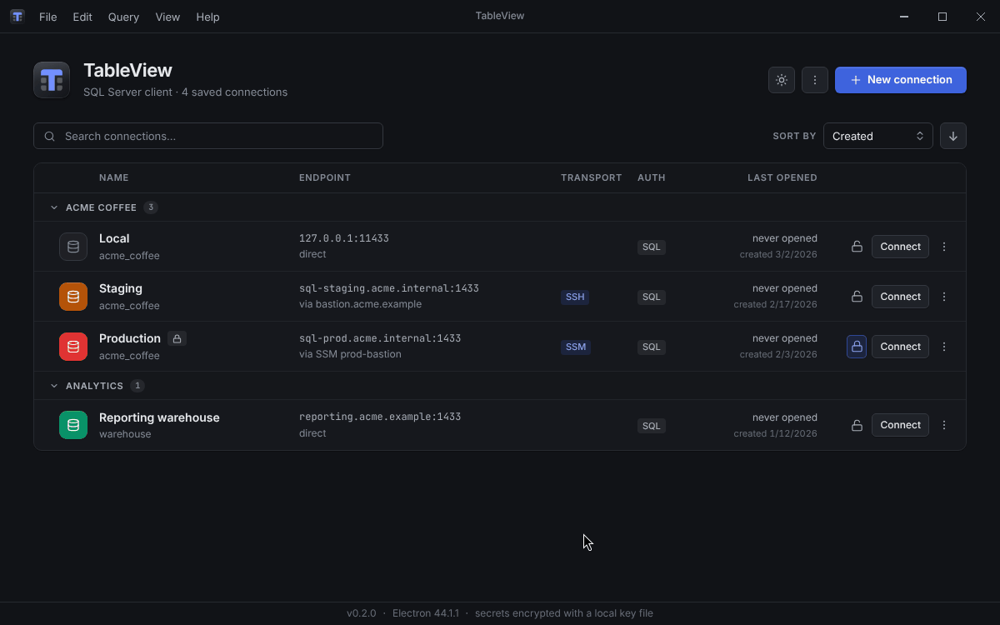
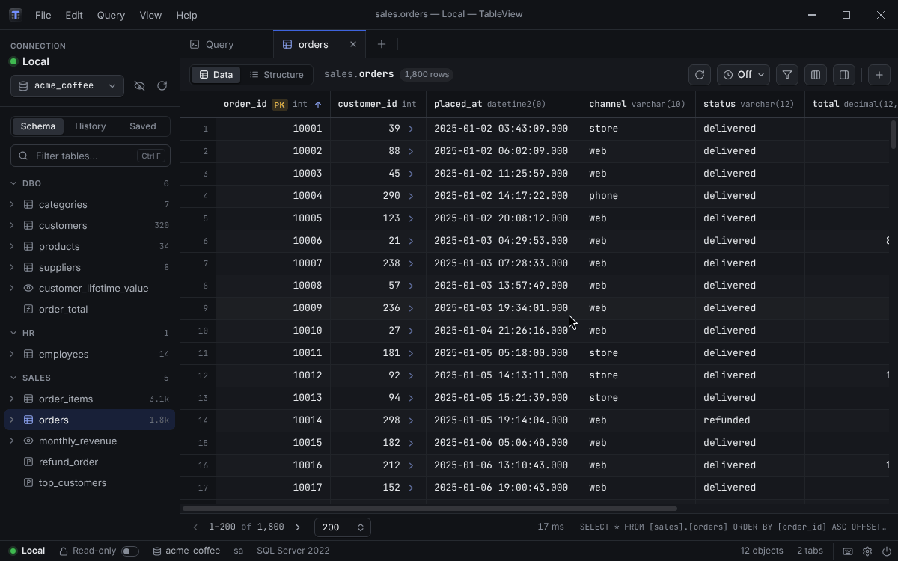
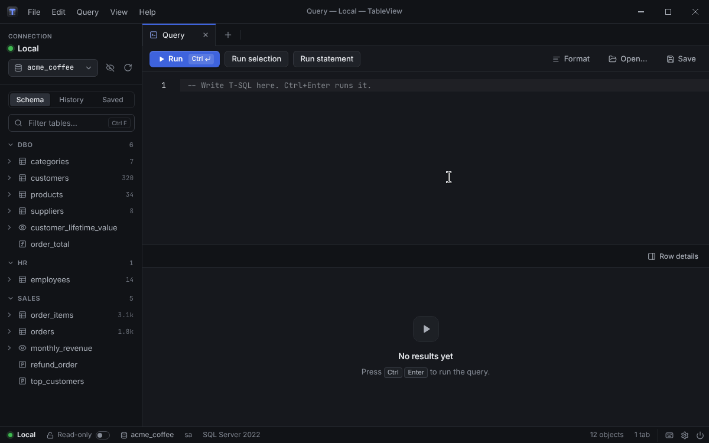
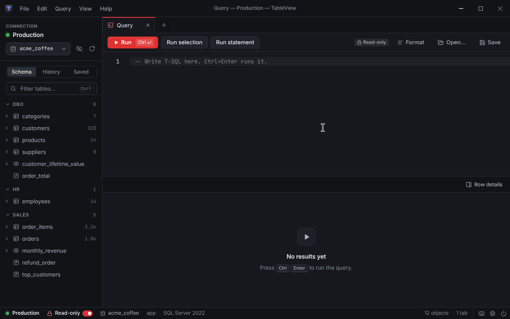

<p align="center">
  
</p>

<h1 align="center">TableView</h1>

<p align="center">
  A desktop client for Microsoft SQL Server, on Windows and Linux.
</p>

<p align="center">
  <a href="https://github.com/NelushaUdaraka/tableview/releases/latest"></a>
  
  
  <a href="LICENSE"></a>
</p>

TableView connects to SQL Server directly, through an SSH tunnel or through an AWS Systems Manager
bastion. It gives you a fast table browser, a T-SQL editor that knows your schema, and safeguards for
the connections where a mistake would hurt. It is built with Electron, Vue 3 and TypeScript.



## Features

**Connections**
- SQL Server logins, Windows (NTLM) and Azure AD password sign-in, with TLS options and named
  instances
- SSH tunnels, and AWS SSM port forwarding that starts the session for you and can find the bastion
  by its Name tag
- Connections filed under groups, each with its own colour; duplicate, export and import them
  (passwords stay out of the file), or bring them over from TablePlus
- Passwords encrypted at rest; idle connections kept alive, and dropped ones reopened

**Tables**
- A schema tree with a database switcher, a filter, pinned tables and row-count estimates; a table
  unfolds into its columns, keys, foreign keys and indexes
- A virtualised grid with server-side paging and sorting, a filter builder or a raw `WHERE`, a column
  picker and optional auto refresh
- Edit cells, add and delete rows — changes are staged, then applied in one transaction
- A row panel that shows JSON as a tree, and foreign keys that open the row they point at
- Export to CSV, TSV, JSON, JSON Lines, SQL `INSERT`s or Markdown



**Queries**
- A T-SQL editor with completion from the live schema, and formatting
- Run everything, a selection or the statement under the cursor; scripts split on `GO`, as in SSMS
- Several result sets per batch, messages, and errors with their line numbers; saved queries and
  history
- Stored procedures and functions open as `CREATE OR ALTER`, with every change from the stored
  version marked, and each one revertible on its own
- Search the text of every procedure, function, view and trigger, and find what uses a table
- Each tab keeps its own session, as an SSMS window does: temp tables, `USE` and transactions carry
  from one run to the next, and an open transaction is shown, and asked about before anything ends it



**Safety**
- Read-only connections: a script that writes is refused before any of it is sent
- Confirm-writes connections: every statement that writes is shown, and waits for a yes, before
  any of it is sent
- Staged edits and unsaved routines are never dropped without asking
- A connection's colour tints its whole window, so production never looks like staging



**Workspace**
- Tabs, a side-by-side split, and tabs that drag out into windows of their own
- One connection per window, and as many windows as you like
- Dark and light themes, and a full menu with keyboard shortcuts (`Ctrl+/` lists them)
- The Windows installer and the Linux AppImage keep themselves up to date

## Download

Get the latest version from the [Releases page](https://github.com/NelushaUdaraka/tableview/releases/latest).
The [changelog](CHANGELOG.md) says what changed in each release.

| System | File | Updates |
| --- | --- | --- |
| Windows | `TableView-<version>-windows-x64-setup.exe` — installer | Automatic |
| Windows | `TableView-<version>-windows-x64-portable.exe` — runs without installing | Tells you when one is out |
| Linux | `TableView-<version>-linux-x86_64.AppImage` (or `-arm64`) | Automatic |
| Debian, Ubuntu | `TableView-<version>-linux-amd64.deb` (or `-arm64`) | Tells you when one is out |

There is no macOS release. [Installing and updating](docs/install-and-update.md) has notes for each
platform, explains how updates work, and covers moving over from Beekeeper Clone, TableView's old
name.

## Getting started

1. Open TableView and choose **New connection**.
2. Fill in the server and login — or paste a URL copied from TablePlus — then press
   **Test connection** and **Save**.
3. Press **Connect**. The sidebar lists the database's tables, views and routines: click a table to
   browse it, or press `Ctrl+T` for a new query tab.

## Documentation

**Using TableView**
- [Connections](docs/connections.md) — saving and organising connections, signing in, SSH tunnels,
  colours
- [Connecting through an AWS bastion](docs/aws-ssm.md) — SSM port forwarding, finding the bastion,
  credentials
- [Read-only and confirm writes](docs/read-only.md) — what is refused or asked about, and how it
  is switched
- [Tables](docs/tables.md) — the schema tree, browsing, filtering, editing and export
- [Query editor](docs/query-editor.md) — running scripts, and editing stored procedures
- [The workspace](docs/workspace.md) — the title bar, panes, tabs and windows
- [Installing and updating](docs/install-and-update.md)
- [Known limitations](docs/limitations.md)

**Working on TableView**
- [Development](docs/development.md) — running from source, building packages, testing
- [Architecture](docs/architecture.md) — how the code is laid out, and the decisions behind it
- [Releasing](docs/releasing.md) — cutting a release

## Building from source

TableView builds with Node.js 22, the version its release workflow uses.

```bash
npm install
npm run dev          # run the app with hot reload
npm test             # unit tests
npm run build:win    # or build:linux — packages land in release/<version>/
```

[Development](docs/development.md) covers the integration and end-to-end tests, and what to do if
`npm run dev` says "Electron uninstall".

## Limitations

TableView is at phase 1, which leaves some things for later:

- SQL Server is the only engine.
- One connection per window — for a second, open another window (`Ctrl+N`).
- No visual schema designer, and no backup, restore, import or diff tools.

[Known limitations](docs/limitations.md) has the full list.

## Licence

[MIT](LICENSE)
